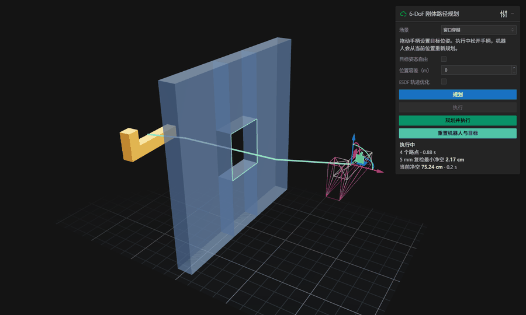
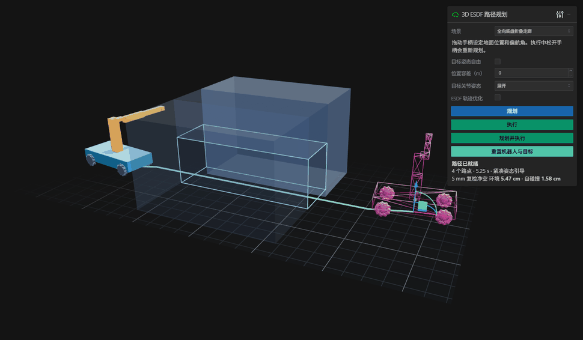
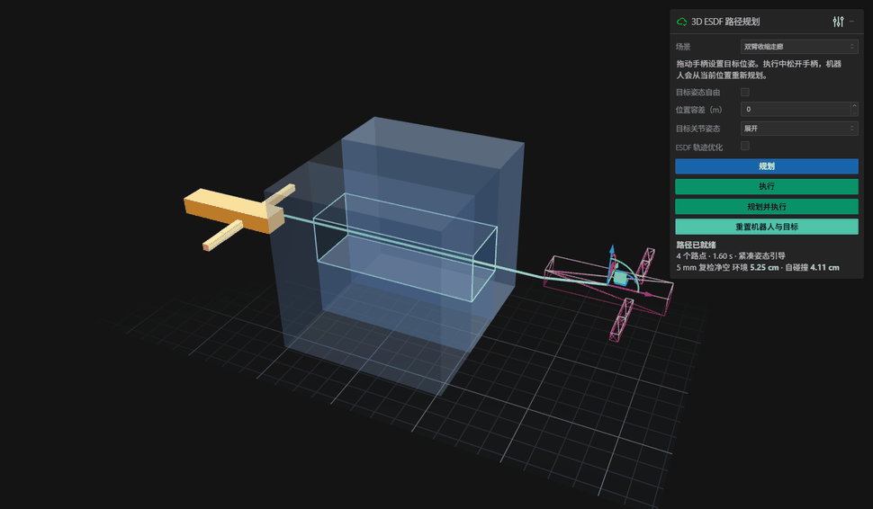

# 3D ESDF 路径规划演示

用 Python、ESDF 和 SE(3) RRT-Connect 规划网格机器人的位姿路径，通过 viser 在浏览器里拖动目标并执行运动学仿真。默认场景中，L 形机器人在初始姿态下沿窗口短边展开 1.34 m，窗口宽 0.80 m、高 0.88 m。墙面覆盖工作空间截面，机器人需要旋转才能穿过窗口。



## 全向底盘与升降折叠机械臂

[麦克纳姆轮移动机械臂 URDF](anyshape_planner/models/mecanum_arm.urdf)包含四轮底盘、24 cm 行程的升降立柱、肩关节、肘关节和夹爪。轮子用圆柱包络做碰撞检测，用斜滚子网格渲染。规划和跟踪将底盘约束在地面 (x, y, yaw)，并用麦克纳姆逆运动学检查四轮速度。仿真使用运动学速度控制。[麦克纳姆逆运动学参考](https://github.com/ros-controls/ros2_controllers/blob/master/mecanum_drive_controller/src/mecanum_drive_controller.cpp#L586-L605)

```powershell
python run_demo.py --scene mobile --port 8082 --open
```



走廊宽 0.78 m、高 0.83 m、长 2.38 m。整机展开时宽约 1.42 m、高 0.94 m，降高并折臂后宽约 0.66 m、高 0.70 m。底盘在入口前横移对正，穿越后恢复展开姿态。界面显示升降位移、肩肘角度、净空和峰值轮速。

```powershell
python -m pip install -r requirements-articulated-tests.txt
python -m anyshape_planner.tests.mobile_benchmark --output mobile_results.json
```

测试包括仅升降、仅折臂、关节全锁定与联合规划的对照，以及平面约束、FCL 密采样复检、关节和轮速限制。[移动机械臂测试数据](mobile_results.json)

## 浮动基座与双臂走廊

双臂场景有 6 个基座自由度和 4 个旋转关节。展开宽度为 1.84 m，收缩后约 0.62 m，走廊宽 0.74 m、高 0.62 m。基座从房间接近走廊时双臂收缩，穿过后重新展开。

```powershell
python -m pip install -r requirements.txt
python run_demo.py --scene corridor --open
```



点击 **规划并执行**。面板显示关节角、环境净空和自碰撞净空，可拖动手柄修改目标基座位姿，并在 **目标关节姿态** 中选择展开或收缩。启动参数 `--port` 可更改监听端口。

`--urdf` 可加载带旋转、连续旋转、直线或固定关节的树形机器人。几何从 `collision` 读取，也可使用 `visual` 几何，支持基本几何体和文件网格。网格文件路径以 URDF 所在目录为基准。同名 `.poses.json` 用关节名指定 `nominal`、`compact` 两组数值，旋转关节使用弧度，直线关节使用米。`--sample-pitch` 可调整几何采样间距，双臂场景的默认值为 0.05 m。连续推进约束基座平移、旋转及所有关节下游点位移。自碰撞使用 link 局部 ESDF，对 URDF 相邻 link 应用允许碰撞矩阵。[双臂 URDF](anyshape_planner/models/dual_arm.urdf) · [姿态配置](anyshape_planner/models/dual_arm.poses.json)

```powershell
python -m pip install -r requirements-articulated-tests.txt
python -m anyshape_planner.tests.articulated_benchmark --stage all --output articulated_results.json
```

10,000 个随机构型与 FCL 对拍的环境和自碰撞合并判定一致率为 99.89%，共 1 个漏检。双臂收缩规划 20/20 成功，中位规划耗时 0.67 s，5 mm 密采样的环境和自碰撞最小净空分别为 5.25 cm 和 4.11 cm。锁定展开姿态时，躯干和双臂在走廊截面内的投影尺寸约束使通行不可行。

20 次规划使用 20 个种子扰动房间内的起终点，并另测一次全维 RRT-Connect。走廊内的姿态指标按基座位于通道内统计，走廊外指标按整机包围球已离开通道统计。净空与对拍结果取决于本次几何和采样分辨率。[双臂测试数据](articulated_results.json)

FK 用 yourdfpy 交叉验证。 [yourdfpy 项目](https://github.com/clemense/yourdfpy)

## 启动

在项目目录中使用 Python 3.11 或更新版本。

```powershell
python -m pip install -r requirements.txt
python run_demo.py --open
```

打开 [本地演示](http://127.0.0.1:8080/)，点击 **规划** 查看绿色路径，然后点击 **执行**。橙色实体是机器人，粉色线框是目标位姿。拖动目标手柄的轴或圆环可修改位置或姿态。执行中拖动并松开手柄时，机器人从当前位置重新规划并继续执行。可在场景下拉框切换到随机盒体和圆柱组成的杂乱环境。

自定义机器人需要封闭的 OBJ 或 STL 网格，顶点坐标单位为米，变换以网格原点为参考。可以通过 `--sample-pitch` 调整机器人采样间距。工作空间和默认起终点由 `scenes.py` 定义。

```powershell
python run_demo.py --robot path/to/robot.stl --sample-pitch 0.05 --open
```

安装可选依赖后，勾选 **ESDF 轨迹优化** 可使用 PyTorch 优化路点。优化固定两端位姿，候选路径须通过连续碰撞检查和 5 mm 复检。

```powershell
python -m pip install -r requirements-optimizer.txt
```

## 复现测试

```powershell
python -m anyshape_planner.tests.benchmark --stage all --output demo_results.json
```

`--stage core` 运行碰撞、规划和控制测试。`collision`、`plan`、`control`、`optimizer` 可分别运行单个阶段。

| 验收项 | 测试结果 |
| --- | --- |
| 窗口场景 10,000 个随机位姿与 FCL 对拍 | 99.30% 一致，70 个保守误报，0 个漏检 |
| 窗口穿越 | 20/20 成功，按刚体点位移上界 5 mm 重采样的最小 ESDF 净空为 6.46 mm，重采样位姿也通过 FCL 检查 |
| 杂乱环境 | 固定障碍布局，10 个规划种子全部成功 |
| 运动学跟踪 | 三次固定目标与一次改目标，终点误差均小于 0.50 mm 和 0.04° |
| PyTorch 优化 | 窗口种子 0 的目标函数从 0.00654 降至 0.00177，FCL 密采样通过，碰撞检查拒绝候选时回退 |

浏览器中实测了分开规划与执行、拖动目标手柄触发重新规划、切换杂乱场景，以及启用 PyTorch 优化。窗口演示终点误差为 0.48 mm 和 0.03°，拖动目标后到达新目标的误差为 0.35 mm 和 0.02°。

逐次耗时和验收数据保存在 [demo_results.json](demo_results.json)。窗口测试采用窗口中心附近的位姿采样偏置，同时保留全空间随机采样。连续推进使用三线性场的 Lipschitz 上界。净空基于离散 ESDF 与有限机器人采样点，换用更细的几何特征时，需要重新验证体素和采样分辨率。对拍的 0 漏检只描述上述测试样本。
