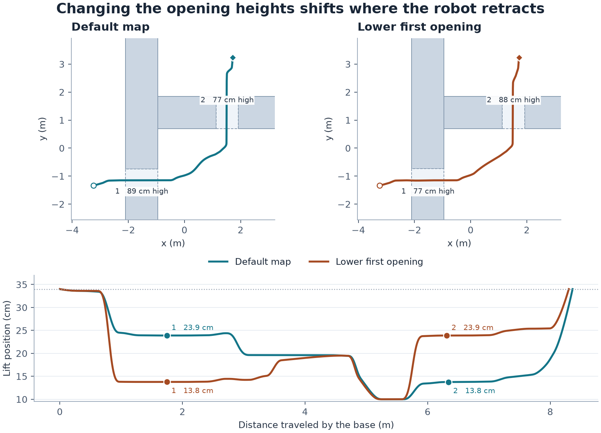

# 全向轮式机器人的变形与运动联合规划

研究原型以 3D-ESDF-Planning v1.5（`2a3a247`）为基线。机器人在平地上通过先后两道宽高不同的窄口，中间转弯。规划输入为静态障碍物、URDF 和起终构型。要验证的假设是，沿参考轨迹只在接近障碍的连杆上构造局部分离项，并用逐连杆运动上界做连续复检，能加快求解，同时让升降和折臂随通道几何变化。

## 从 SCAN-Planner 迁移的思路

SCAN-Planner 用随航向旋转的双圆柱近似四足机体，由位置切线推导偏航。它用膨胀占据查询识别碰撞段，由投影 A* 引导路径构造局部反弹方向，再优化 B 样条。我们保留按需构造局部碰撞项的思路。麦克纳姆底盘可横移，因此偏航独立于速度方向，连杆几何由升降和肩肘关节共同决定。研究版从现有分层全身构型图取得初值，用五次 Bézier 样条表达全身轨迹。局部平面来自箱体的支撑点。GCOPTER 参考实现提供了空间与时间参数化的后续方向。 [SCAN-Planner §IV–V](https://arxiv.org/html/2606.19555v1#S4) · [EGO-Planner](https://arxiv.org/abs/2008.08835) · [GCOPTER 与 MINCO](https://arxiv.org/abs/2103.00190)

## 当前实现

1. **生成全身初值。** 地图高度切片上的 A* 寻找引导通道。分层构型图选择 \(q=(x,y,\psi,h,\theta_s,\theta_e)\)，开口尺寸和位置只用于生成测试障碍物。参考姿态仍用于生成候选。图上点筛选保留 ESDF，箱体地图上的边优先使用解析净空。
2. **选择连杆和障碍物对。** 在每段的 1/4、1/2 和 3/4 处，用当前全身构型计算每个连杆的直立包围盒。对投影间隙小于 55 mm 的连杆和障碍物对，固定参考点处分离轴 \(n\)，取面向障碍的支撑点 \(p\)。平面近似为 \(g(q+\Delta q)\approx g(q)+n^TJ_p(q)\Delta q\)。平移、偏航、直线关节和转动关节都可以贡献梯度。
3. **求解局部样条。** L-BFGS-B 优化内部全身路点和共享切向速度。目标包括加权 jerk 平方积分、对参考样条的偏移、关节展开偏好及分离平面的单边平方惩罚。末端位姿和速度固定。联合优化维持 \(C^2\)，用相邻的 Bernstein 控制点限制关节位置，用导数凸包和统一时间缩放满足轮速、关节速度和关节加速度。加速度限值为仿真设定，升降为 3 m/s²，肩肘各为 12 rad/s²。
4. **独立验收。** 环境距离取直立连杆包围盒与障碍物箱体的几何间距，保留局部 ESDF 自碰撞检查。各连杆按其自身的祖先关节计算位移上界，用净空界定可连续通过的时间区间。优化候选要通过整段连续验证与 5 mm 网格净空复检。失败时尝试参考样条或原 ESDF 流程。

参考实现放在 `3rd_part/`，新代码使用本项目的 URDF、关节树和五次多项式接口。 [几何净空](../anyshape_planner/box_clearance.py) · [优化器](../anyshape_planner/whole_body_optimizer.py) · [验收](../anyshape_planner/trajectory.py) · [搜索与回退](../anyshape_planner/map_motion.py)

## 复现实验

```powershell
python -m pip install -r requirements-articulated-tests.txt
python -m anyshape_planner.tests.whole_body_benchmark --output whole_body_results.json
python -m anyshape_planner.tests.tracking_benchmark --output whole_body_tracking_results.json
python run_demo.py --scene map --port 8086 --open
python run_demo.py --scene map-low-first --port 8087 --open
```

测试包含默认双窄口、首口更低、第二口更低、双宽口。每张图测试四个目标位置。报告计时包括搜索、优化和复检，地图初始化、FCL 和播放在计时之外。v1.5 对照使用旧搜索和 ESDF 复检，所有对照采用相同的仿真关节加速度限值。对比项包括几何复检、只优化底盘、全身优化和关闭障碍分离平面。锁定关节的实验使用同一搜索器和展开参考构型，失败表示该搜索器未找到路。 [实验代码](../anyshape_planner/tests/whole_body_benchmark.py) · [逐例结果](../whole_body_results.json)

## 实验结果

Windows、Python 3.13.12。每个场景和目标组合测一次，分位数描述这 16 个任务，运行间波动需另测。

| 方法 | 成功 | P50 | P95 | 有内部停车的任务 |
| --- | ---: | ---: | ---: | ---: |
| v1.5 搜索与 ESDF 复检 | 16/16 | 1.72 s | 2.24 s | 1 |
| 几何检查与参考样条 | 16/16 | 1.05 s | 1.21 s | 0 |
| 几何检查与仅优化底盘 | 16/16 | 1.08 s | 1.15 s | 0 |
| 几何检查与全身优化 | 16/16 | 1.05 s | 1.41 s | 0 |
| 全身优化关闭障碍分离平面 | 16/16 | 1.06 s | 1.14 s | 0 |

全身优化的加权 jerk 积分，相对于仅换几何检查和仅优化底盘，逐任务比值的中位数分别下降 36.1% 和 32.1%。四种开口组合都通过，最终全身轨迹共 77,062 个 5 mm 构型通过 FCL 复核。封住第二口时拒绝规划。锁定升降、锁定肩肘或锁定全部关节时，默认场景的搜索均未找到解。

| 场景 | 第一口升降位置 | 第二口升降位置 | 开启分离平面后的环境净空 | 关闭分离平面的环境净空 |
| --- | ---: | ---: | ---: | ---: |
| 默认双窄口 | 23.89 cm | 13.75 cm | 25.27 mm | 25.25 mm |
| 首口更低 | 13.77 cm | 23.88 cm | 21.17 mm | 8.94 mm |
| 第二口更低 | 23.89 cm | 11.52 cm | 22.08 mm | 8.84 mm |



净空取每种场景默认目标的 5 mm 网格最小值，采用同一几何模型。升降值是开口截面附近的中位数。仿真加速度限值会影响标称运动时长，例如默认全身优化轨迹标称 25.42 秒。计时提升主要来自解析几何检查，分离平面主要改善困难场景的净空。

宽口对照里的肩关节仍在开口附近折叠约 94°。目前局部调整范围受搜索初值限制，尚未验证宽松空间里能否避免多余变形。

## 闭环跟踪仿真

控制器根据测得的底盘位姿和关节位置，结合样条速度前馈，输出四轮角速度与三个关节速度。仿真用麦克纳姆正运动学、轮速一阶响应和关节加速度限幅推进状态，以 50 Hz 用 FCL 检查实际轨迹。两个场景分别测试无扰动、40 ms 延迟与 5% 横向轮滑、60 ms 延迟与 10% 横向轮滑。六组轨迹都到达目标，采样构型通过 FCL。 [控制器](../anyshape_planner/controller.py) · [跟踪数据](../whole_body_tracking_results.json)

| 60 ms 延迟与 10% 轮滑 | 最大位置误差 | 最大偏航误差 | 最大升降误差 | 采样最小环境净空 |
| --- | ---: | ---: | ---: | ---: |
| 默认双窄口 | 12.8 mm | 0.88° | 5.1 mm | 20.9 mm |
| 首口更低 | 8.5 mm | 0.66° | 3.0 mm | 17.6 mm |

## 投稿前需要的证据

TopAY 已有轮式移动机械臂的全身轨迹规划，KC-SVSDF 也有沿运动链传播避障梯度与窄口实物验证。论文应检验本文的具体机制，即少量局部支撑平面、逐连杆连续净空界与六维联合优化相结合，在何种窄口分布下能改善耗时、运动连续性和最小净空。现有原型覆盖直立连杆、静态箱体图和带扰动的运动学跟踪仿真。 [TopAY](https://arxiv.org/abs/2507.02761) · [KC-SVSDF](https://arxiv.org/abs/2608.07005)

- 扩大到独立生成的地图与起终构型，包含多路线、不同转弯半径、宽度与顶板高度的组合。报告成功率、P50/P95、最坏净空和内部停点数量，并按窄口难度分层。
- 加入冻结姿态、先停车变形再行驶、完整全身规划三个对照，并让相同的目标、运动约束和验证口径贯穿各组。
- 在实物上测量延迟、轮滑、关节响应及跟踪误差，用这些数据设定净空预算。比较重复通过的成功率和失败模式，并加入公开全身规划器的同口径对照。
